# Your first app in 5 minutes

This tutorial describes how to get started with Ocsigen quickly. Thanks to an application template provided by the Ocsigen team, you will get to a working application with standard functionality like users and notifications in only a few minutes. This template can be used for learning purposes, or even as a starting point for your own product.

The template you will use comes from `Ocsigen Start`. Ocsigen Start provides a complete mechanism for adding and managing users, including activation links and password reset. It additionally contains a module for displaying tips, a module for sending notifications to your users, and other utilities typically needed in modern Web applications.

The template comes with a default style (developed with SASS) that follows modern Web practices, e.g., it is responsive and thus mobile-friendly. Of course, you are free to modify the style to match your own brand or personality.

The template is multi-platform. This means that it can run on a Web browser or as a mobile app for Android or iOS.

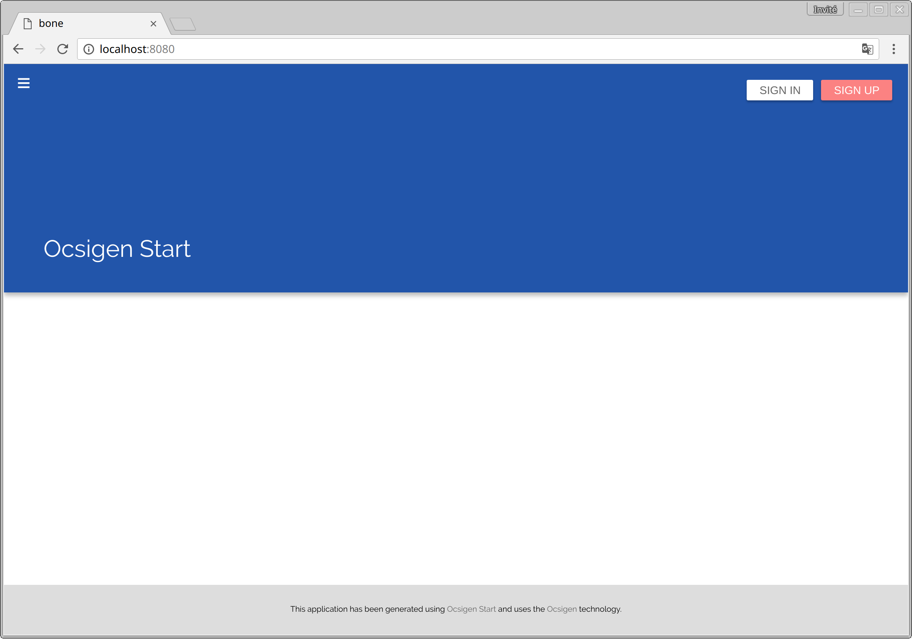
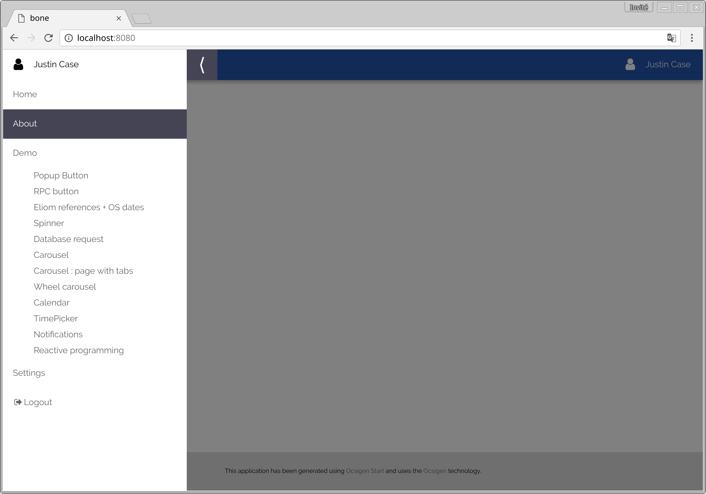

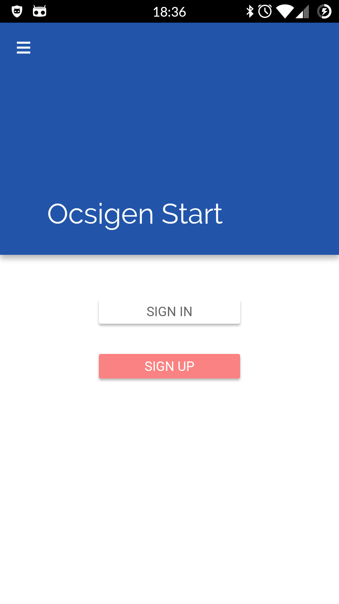
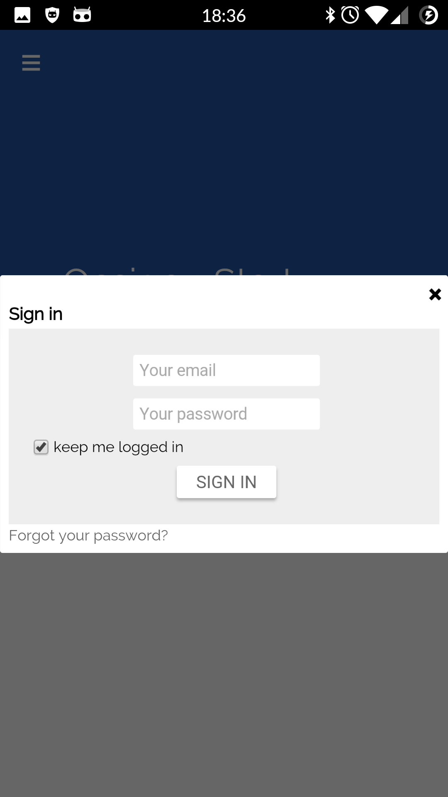
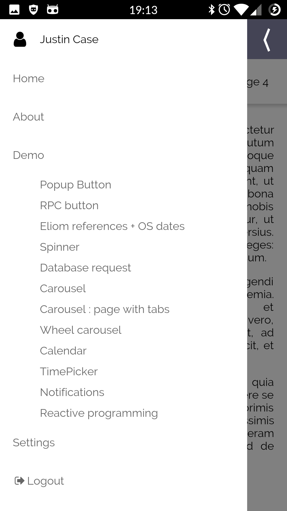

## Installation

Install the system dependencies: the PostgreSQL server, NPM, and a SASS compiler (`sassc` or `sass`). On Debian-based systems:

```
apt install postgresql npm sassc
```
Install Ocsigen Start and all its OCaml dependencies using OPAM:

```
opam install ocsigen-start
```
Create your application using Eliom distillery:

```
eliom-distillery -name myapp -template os
```
Then, from the new `myapp` directory, create a local database (it runs as your own user, with its files in `local_db/`), and compile and run the application:

```
make db-init
make db-create
make db-update
make test.byte
```
The application is now available at [`http://localhost:8080`](http://localhost:8080). To create your first user, sign up: if no mail server is configured on your machine, the activation link is printed in the terminal.

The database server listens on port 3000\. If this port is taken, change `DB_PORT` in `Makefile.options` and `PGPORT` in `dune.config` before running `make db-init`.

The `README.md` file of the generated project describes the other `make` targets and how to generate the mobile applications.

## I installed it and compiled it, what next?

It is now time to learn Ocsigen\! The template is a great way to get started, because it comes with multiple runnable examples that show you:

- How to do remote procedure calls (RPCs);
- How to save session data (in *Eliom references*);
- How to use the notification system;
- How to create reactive pages;
- Many examples of widgets from `Ocsigen Toolkit`:

  - Carousel
  - Pages with several tabs
  - Time and date pickers
  - ...
Open the demo pages from the menu of the application. Their source code is in the `lib/demo_*.eliom` files of your project. These files are well-commented, so you can quickly find out how things work.

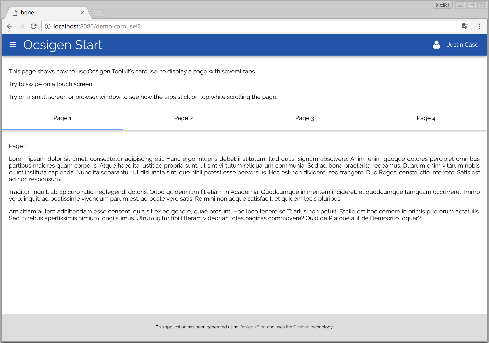
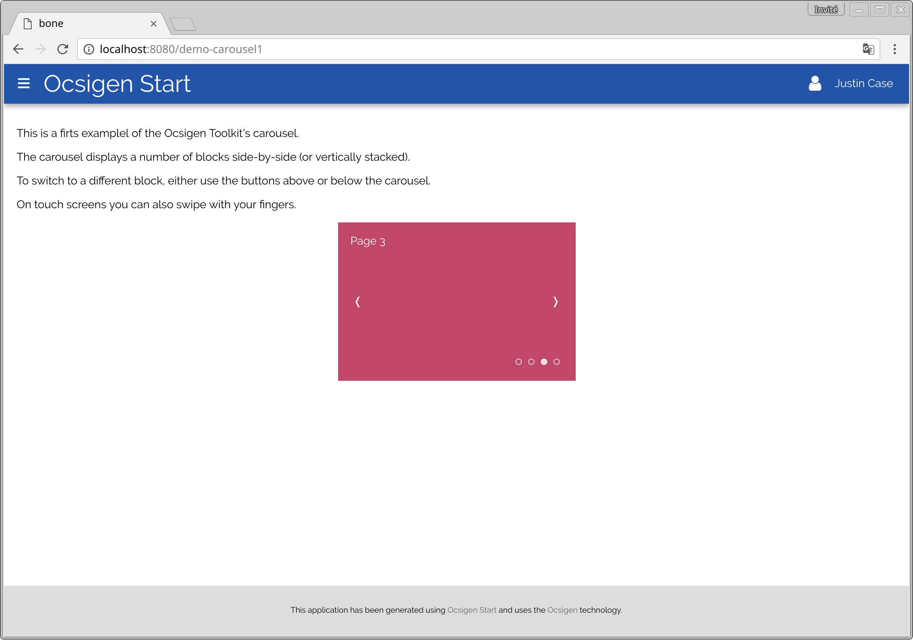
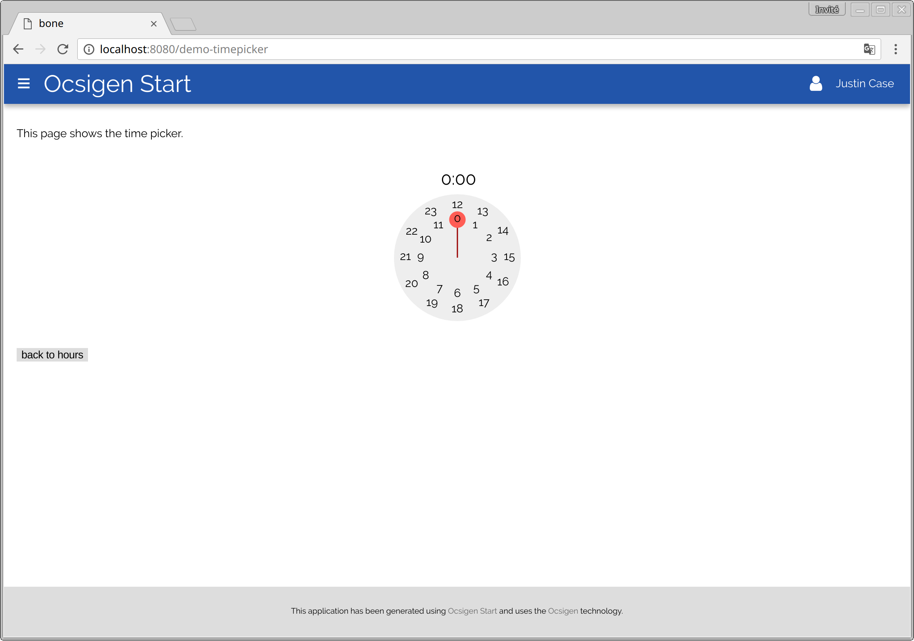
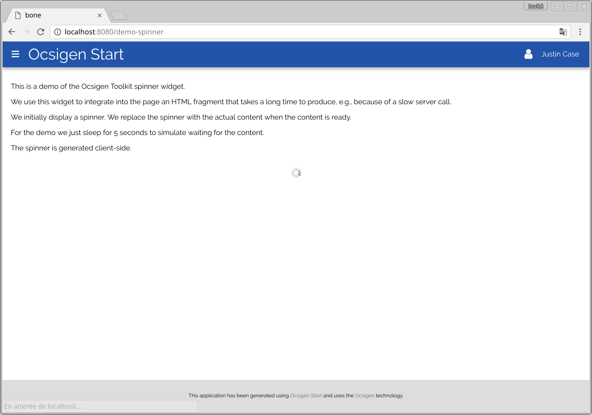

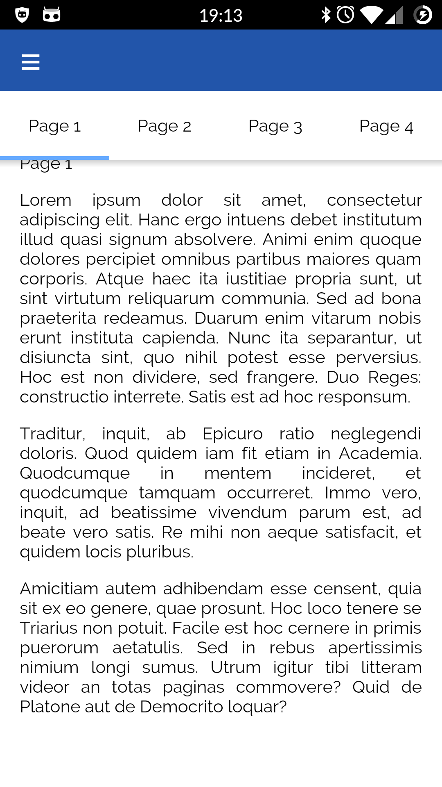
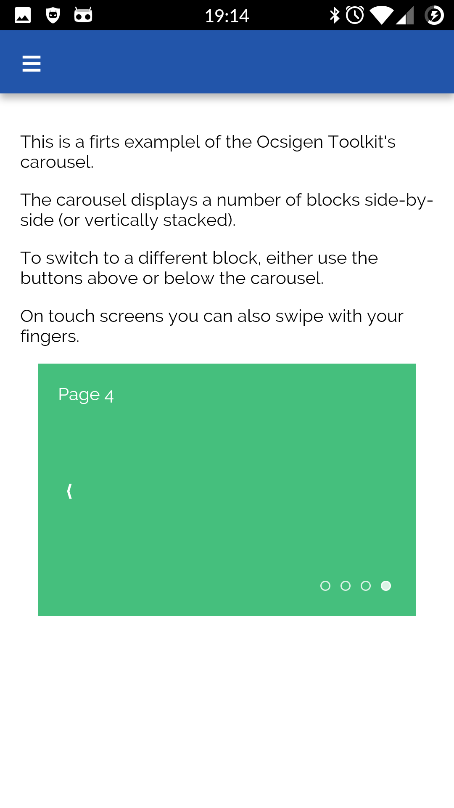
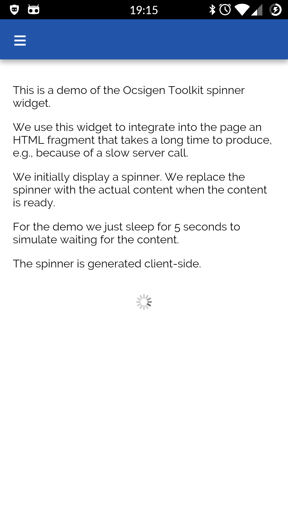
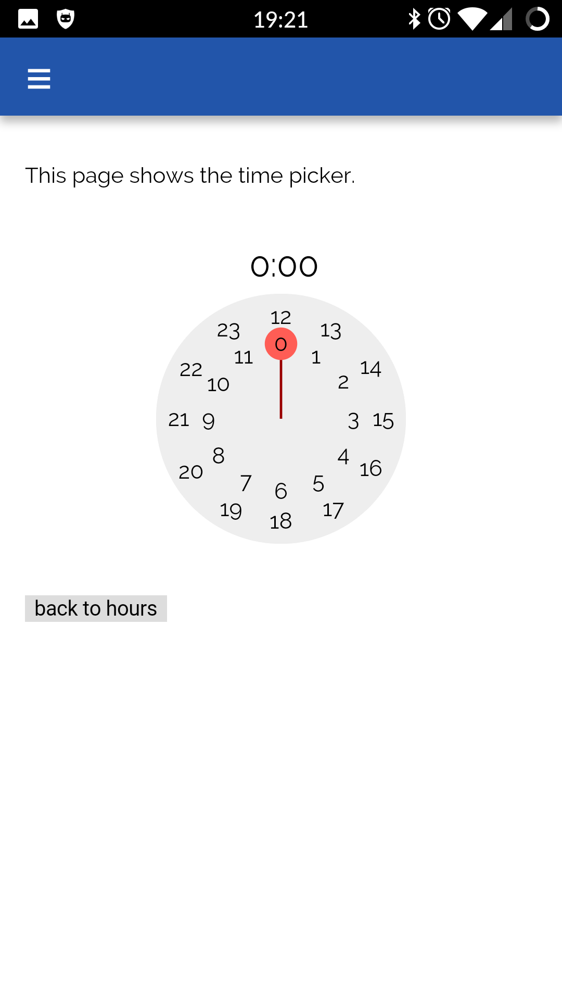

Have fun\!
